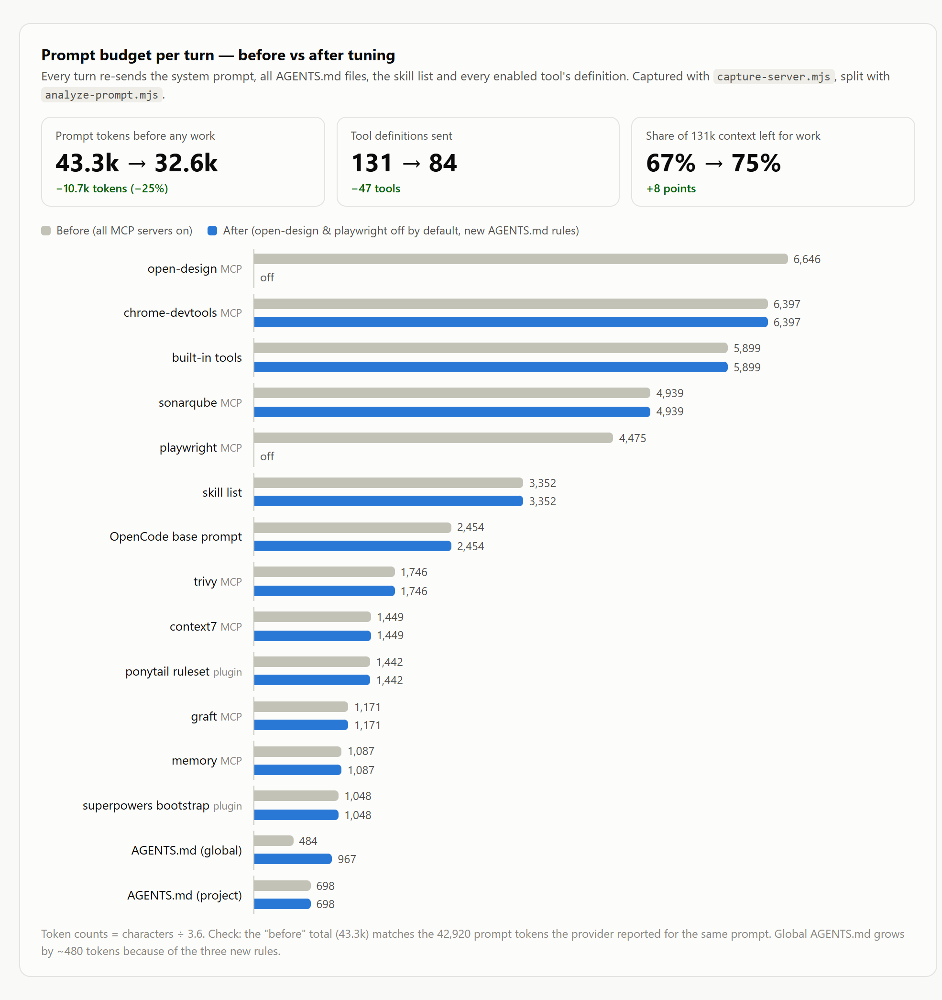
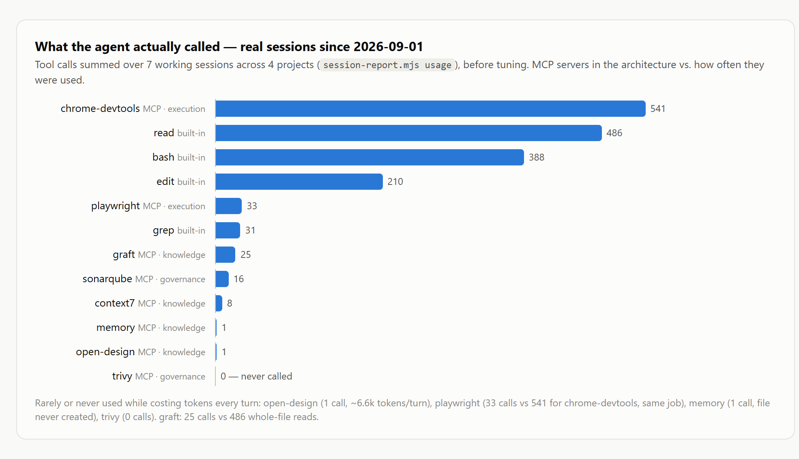
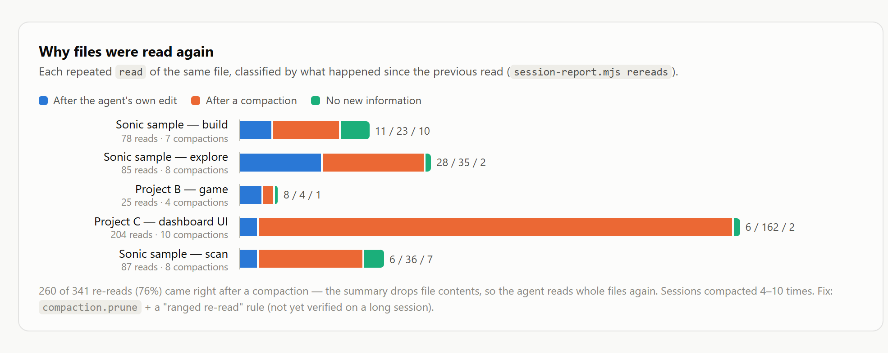
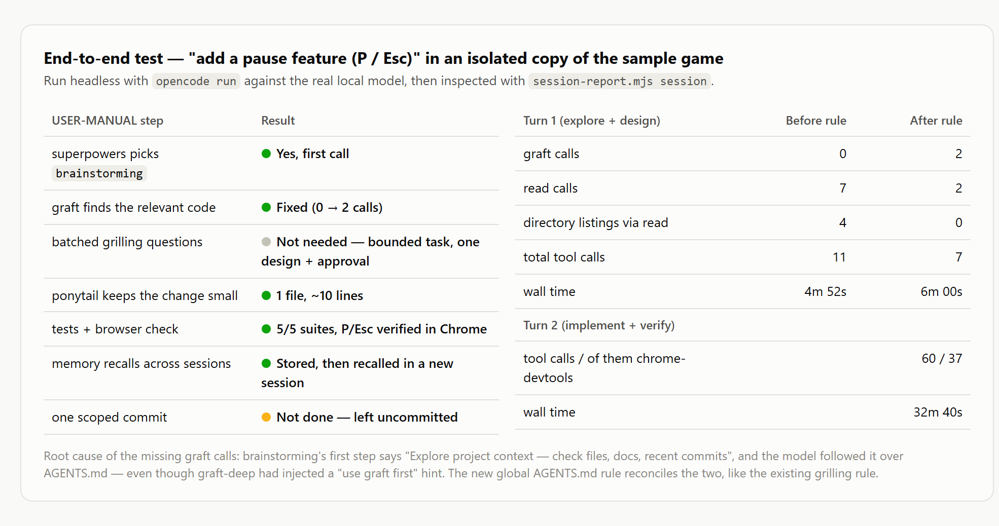

# Tuning — measure first, then make the workflow actually happen

Overview at [[index]] · functional layers at [[architecture]] · workflow at [[USER-MANUAL]] · problems at [[gotchas]]

A complete config is not the same as a working workflow. Every MCP server showing `connected` and every skill loading tells you nothing about whether the agent actually **uses** them in the order [[USER-MANUAL]] and [[architecture]] describe. This page records four real measurements (all run locally — nothing leaves the machine), what they showed, and what was changed because of them.

> [!info] Results at a glance (measured 2026-10-03 · OpenCode 1.18.34 · graft 0.21.1 · self-hosted Qwen3.8 27B, 131k context)
> | What was measured | Before | After |
> | --- | --- | --- |
> | Prompt per turn, before any work | ~43.3k tokens (131 tools) | **~32.6k tokens (84 tools), −25%** |
> | Agent uses graft while exploring (E2E, turn 1) | 0 calls, 7 reads | **2 calls, 2 reads** |
> | memory MCP | 1 call in 50 sessions, file never created | **stores and recalls across sessions** |
> | Re-reading files | 76% happen right after a compaction | `compaction.prune` + a re-read rule (**not yet verified on a long session**) |
> | Adding Caveman + benjamin-plus (section 8) | — | **no measurable improvement** — Caveman kept because replies read better (prompt becomes ~34.0k), benjamin-plus removed |
>
> **OpenCode 2 (2026-10-11):** the prompt per turn fell to **~14.2k** tokens (Code Mode), and the plugins, skill filter, compaction and AGENTS.md rules all had to be redone. Re-measured in **section 9**.

All scripts are in [`scripts/`](../scripts/) — they need only Node.js (≥ 22.5 for `session-report.mjs`, which uses the built-in `node:sqlite`). The HTML source of every image on this page is [`assets/tuning/report.html`](../assets/tuning/report.html).

---

## 1. Measure the prompt size per turn

Every turn, OpenCode re-sends the system prompt, every AGENTS.md, the skill list, and **the definition of every tool from every enabled MCP server**. That is the fixed "entry fee" paid before any real work, and it comes straight out of a local model's 131k context.

### How — capture the real request with a fake endpoint

Same idea as [[gotchas]] item 8 (pointing `baseURL` at a local proxy), but no real model is called at all — [`capture-server.mjs`](../scripts/capture-server.mjs) is an OpenAI-compatible endpoint that records each request and answers `ok`.

```bash
# terminal 1 — start the fake endpoint
node scripts/capture-server.mjs ./capture

# terminal 2 — let OpenCode send one prompt (your real config is untouched — OPENCODE_CONFIG_CONTENT is merged on top for this process only)
# OpenCode 2: add --standalone, otherwise the request goes to the background service, which never sees the variable
cd my-project
OPENCODE_CONFIG_CONTENT='{"provider":{"capture":{"npm":"@ai-sdk/openai-compatible","options":{"baseURL":"http://127.0.0.1:18555/v1"},"models":{"fake":{"limit":{"context":131072,"output":32768}}}}}}' \
  opencode run --standalone -m capture/fake "Reply with exactly the word: ok"

# split it into buckets
node scripts/analyze-prompt.mjs ./capture/req-02.json
```

In PowerShell, set the variable like this instead: `$env:OPENCODE_CONFIG_CONTENT='{...}'; opencode run -m capture/fake "..."`

> [!note] Which file is the main prompt
> On OpenCode 1 you get two files — the small one (`req-01`) is the session-title request; the big one (`req-02`) is the prompt the model really receives on the first turn. On OpenCode 2 a short `run` produced only one file, the main prompt.

> [!tip] How accurate are the token numbers
> `analyze-prompt.mjs` estimates tokens as characters ÷ 3.6 — the "before" total (~43.3k) was checked against the 42,920 prompt tokens the provider actually reported for the same prompt. If you have your own real number, pass `--tokens <N>` to calibrate the ratio exactly.

### Result



What it shows:
- **The three browser-side MCP servers (open-design, chrome-devtools, playwright) took ~17.5k tokens together — 40%** of the whole prompt — even though most work never touches a browser
- open-design alone was ~6.6k tokens (22 tools + the server's own instructions) — and it is only used when pulling work in from OpenDesign ([[USER-MANUAL]] section 5)
- The 25-skill list (~3.4k), the ponytail ruleset (~1.4k), and the superpowers bootstrap (~1k) are all sent **every turn**, not only when a skill is invoked

---

## 2. See which tools the agent really calls

OpenCode stores every tool call of every session in its own database (`~/.local/share/opencode/opencode.db`) — [`session-report.mjs`](../scripts/session-report.mjs) reads it read-only and summarizes it.

```bash
node scripts/session-report.mjs usage --since 2026-09-01
```



Against [[architecture]], layer by layer:

| Layer | As designed | What actually happened |
| --- | --- | --- |
| KNOWLEDGE | graft, graft-deep, context7, memory, open-design | **graft 25 calls vs 486 whole-file `read`s** · memory 1 call (`memory.jsonl` never created) · open-design 1 call |
| REASONING | brainstorming, grilling, writing-plans | ✅ brainstorming and writing-plans used consistently · grilling invoked as its own skill only twice — per the AGENTS.md rule it should mostly run as a question format inside brainstorming, which doesn't count as a skill call (not yet checked whether that format is always used) |
| EXECUTION | ponytail, playwright, chrome-devtools | ✅ chrome-devtools 541 calls · **playwright 33 calls** — the same job as chrome-devtools |
| GOVERNANCE | verification, sonarqube, trivy | sonarqube used in 1–6 sessions · **trivy 0 calls** |

---

## 3. Why files get read again

A high `read` count doesn't always mean "not using graft" — OpenCode requires a `read` before an `edit` anyway. So this looks only at **repeated** reads of the same file, and at what happened since the previous read.

```bash
node scripts/session-report.mjs rereads --since 2026-09-01
```



**260 of 341 re-reads (76%) came right after a compaction** — a typical session compacts 4–10 times, the compaction summary drops file contents, and the agent reads whole files again (one session re-read 162 times after compactions; its re-read output totalled ~221k tokens). The root cause is **compacting too often**, not graft.

---

## 4. End-to-end test in a copy of the project

Ask for a real feature, like the worked example in [[USER-MANUAL]] section 3, and check whether the agent follows the 9 steps — **always in a copy**, never in the real project.

```bash
git clone ~/code/my-project ~/tmp/my-project-e2e
cp ~/code/my-project/AGENTS.md ~/code/my-project/opencode.json ~/tmp/my-project-e2e/   # uncommitted files must be copied by hand
cd ~/tmp/my-project-e2e && graft build

opencode run --title e2e-pause "please add a pause feature to the game: pressing P (or Esc) pauses and resumes gameplay"
node /path/to/scripts/session-report.mjs session e2e-pause   # inspect turn 1

# answer / approve in the same session
opencode run -s <session-id> "go ahead"
```

> [!note] `opencode run` has no `question` tool
> In headless mode OpenCode doesn't give the model the `question` tool (visible in the request captured in section 1), so brainstorming asks in plain text and ends the turn — continue with `opencode run -s <id>` without anything hanging. Find the session id with `opencode session list`.



What happened:
- ✅ `brainstorming` was always called first, and the small task got a narrow design (1 file, ~10 lines) — ponytail at work
- ✅ All existing tests ran, and P/Esc were verified in a real Chrome via chrome-devtools
- ❌→✅ **graft was never called** — even though graft-deep had injected a "use graft first" hint. Root cause: `brainstorming`'s first step reads *"Explore project context — check files, docs, recent commits"*, and the model followed the skill (ran `git log`, `read` directories one by one) over AGENTS.md — the same kind of conflict the grilling reconciliation rule in [[plugins]] solves. Fixed with a new rule in the global AGENTS.md (section 5), then the same request was re-run: graft 0 → 2 calls, `read` 7 → 2 (only the file it was about to edit)
- ⚠️ **No commit** at the end (step 9) — no rule forces it yet, because that would make the agent commit on its own in every project
- ⚠️ **Browser verification is slow** — the implementation turn took 32 minutes, 37 of its 60 tool calls were chrome-devtools (mostly `evaluate_script`), and every step re-sends a growing prompt (up to ~81k tokens) for the local model to process again

> [!tip] A real bug came out of it
> During the test the agent found that the sample game's menu crashed on boot (scenes still called an old API name after a refactor) — a periodic end-to-end run also catches problems the code's own tests don't cover.

---

## 5. What was changed (the config in use after testing)

> [!tip] The end result is in real files under [`config/`](../config/README.md)
> [`config/opencode.jsonc`](../config/opencode.jsonc) (a template with everything below already in it) and [`config/AGENTS.md`](../config/AGENTS.md) (all the rules) — the subsections below explain the reason for each part.

### 5.1 Rarely used MCP servers off by default, on per project

In `~/.config/opencode/opencode.jsonc`:

```jsonc
"open-design": {
  "type": "local",
  "command": ["od", "mcp"],
  "timeout": 30000,
  "enabled": false        // ~6.6k tokens/turn, only needed when pulling work in from OpenDesign
},
"playwright": {
  "type": "local",
  "command": ["npx", "-y", "@playwright/mcp@latest"],
  "timeout": 30000,
  "enabled": false        // overlaps chrome-devtools; e2e suites still run with `npx playwright test` via bash
}
```

Turn one on for a single project in `<project>/opencode.json` (merged with the global config — only the changed field is needed):

```jsonc
{ "mcp": { "open-design": { "enabled": true } } }
```

### 5.2 Turn on `compaction.prune` (OpenCode 1 — on OpenCode 2 see section 9)

```jsonc
"compaction": { "auto": true, "prune": true }
```

`prune` (off by default) runs at the end of each prompt: it drops tool outputs older than the last 2 turns, always keeping the newest ~40k tokens, and only acts once there is more than ~20k tokens to drop (checked in the OpenCode 1.18.34 source). Pruning in large, infrequent chunks keeps llama.cpp's prompt cache from being invalidated every turn, while making full compactions less frequent.

### 5.3 Four new rules in the global AGENTS.md

Appended after the existing grill-me rule ([[plugins]]) in `~/.config/opencode/AGENTS.md` (~610 tokens together). "Verifying UI changes" was added later, because of the result in section 8:

```markdown
## Verifying UI changes — once, in a real browser

Passing tests is not enough for a change someone will see in a browser (a
web page, a game). Before reporting done, verify it once with
chrome-devtools: load the page, do the one interaction the task is about,
and check the console for errors. Keep it to a handful of calls — a single
short wait for the page to settle, no polling loops. If the page cannot
load or throws, that is a failure to report or fix, not "done".

## Exploring a codebase — graft first, even inside a skill

Skills such as `brainstorming` ("Explore project context — check files,
docs, recent commits") tell you to look around the project. When the
project has a `graft/` index, do that step through graft instead of
listing directories and reading files one by one:
`graft_graft_repo_map` for orientation, `graft_graft_find_code` for "where
is X / how does Y work", `graft_graft_file_api` to skim a file, and
`graft_graft_trace_calls` for callers. Then `read` only the files you are
about to edit. Directory listings and whole-file reads are the fallback
when there is no `graft/` index.

## Re-reading files after compaction or pruning

When you need a file you already read earlier in this session (its content
was compacted or pruned away), do not re-read the whole file. If the
project has a `graft/` index, run `graft skeleton <file>` or `graft ask
"<symbol>" --source` first; then `read` only the lines you need with
`offset`/`limit`. A full read is fine right before editing a file you
have not read since the last compaction.

## Memory — facts that must outlive this session (memory MCP)

- Before asking the user about a preference or a past decision, call
  `memory_search_nodes` with the project's folder name (and "user") — the
  answer may already be stored.
- When the user states a durable preference, or brainstorming/grilling
  settles a decision that later sessions will need, save it:
  `memory_create_entities` for a new project/user entity, otherwise
  `memory_add_observations` — one short sentence per fact, prefixed with
  today's date (YYYY-MM-DD).
- Never store secrets, code, or anything the repo already records
  (graft, git history, specs under `docs/`).
```

> [!important] Tool names must match what the model actually sees
> OpenCode names MCP tools `<server>_<tool>`, so graft's become `graft_graft_find_code` and so on. Check the real names in the request captured in section 1 before writing a rule that names a tool.

The memory rule, tested with the real model: session 1 said "remember …" → the agent called `memory_search_nodes`, then `memory_create_entities` with the date · a new session asked back → the agent called `memory_search_nodes` until it found the fact and answered correctly.

### 5.4 Keep other tools' skills out — `OPENCODE_DISABLE_EXTERNAL_SKILLS=1` (OpenCode 1 — on OpenCode 2 see section 9)

OpenCode also loads skills from `~/.claude/skills` (Claude Code) and `~/.agents/skills` automatically — on a machine with several AI tools installed, the skill list grew from 25 to 86 (every one of them sent every turn, and a small model picks the wrong one more easily). Set a user-level env var:

```powershell
[Environment]::SetEnvironmentVariable('OPENCODE_DISABLE_EXTERNAL_SKILLS','1','User')   # Windows
```

```bash
export OPENCODE_DISABLE_EXTERNAL_SKILLS=1   # macOS/Linux — put it in your shell profile
```

Check with `opencode debug skill` — only the skills from superpowers, ponytail, i-have-adhd, grill-me/grilling, and OpenCode's own `customize-opencode` should remain. Why not `OPENCODE_DISABLE_CLAUDE_CODE_SKILLS`: see [[gotchas]] item 15.

### 5.5 context7 — send the API key as a header from an env var

If you have a context7 key (optional — it works without one, just rate-limited), never write the key into the config:

```jsonc
"context7": {
  "type": "remote",
  "url": "https://mcp.context7.com/mcp",
  "headers": { "CONTEXT7_API_KEY": "{env:CONTEXT7_API_KEY}" },
  "enabled": true
}
```

---

## 6. Not fixed yet / to follow up

- **The effect of `prune` + the re-read rule** — the test sessions were too short to compact at all. Run `session-report.mjs rereads` again after some real use and compare the "after a compaction" share against the original 76%
- **The commit step** — to match [[USER-MANUAL]] step 9, add an AGENTS.md rule to make one scoped commit after verification passes (no push) — decide yourself whether you want the agent committing on its own
- **Browser verification** — 37–40 calls / 33–36 minutes for a small feature on OpenCode 1. A token-efficiency rule set didn't help (section 8). On OpenCode 2 the same feature took 15 minutes in total (section 9), and part of that time was spent writing a throwaway web server, which the UI rule now replaces with `npx http-server`
- **trivy never called** — still enabled per [[architecture]] (~1.7k tokens/turn). If it is still 0 on a re-measure, consider turning it off and having the agent run `trivy fs .` via bash, or put it in CI per [[sdlc]]

---

## 7. Tools tried and not kept (and why)

| Tool | What it does | Result | Why it wasn't kept |
| --- | --- | --- | --- |
| [Langfuse](https://github.com/langfuse/langfuse) self-hosted + [opencode-observability-plugin](https://github.com/langfuse/opencode-observability-plugin) | full trace of every turn: prompt, generation, tool calls, reasoning, tokens | ✅ works — traces landed in the local Langfuse | stores full content including tool output (files the agent read); 6 Docker containers, ~2.6 GB RAM — removed by preference |
| [opencode-observability](https://github.com/abekdwight/opencode-observability) | dashboard/monitor on `127.0.0.1`, reads `opencode.db` | ✅ works | parts of the UI are in Japanese |
| [token-optimizer](https://github.com/alexgreensh/token-optimizer) | quality score, compaction guidance, session continuity | evaluated from source, not installed | the OpenCode plugin has **no** tool-output compression (the savings in its README come from Claude Code); automatic nudges start at ≥ 25% context fill, which this setup exceeds from turn 1; PolyForm Noncommercial license |
| [benjamin-plus](https://github.com/JetBrains/benjamin-plus-skill) (JetBrains) | ~880 tokens of rules: one-pass recon, keyhole reads, poll rarely, "done = the check passes" | installed via `instructions` and measured (section 8) | no drop in time or tool calls once every step is done, and it made the agent skip the browser check ([[gotchas]] item 19) — removed |
| [caveman](https://github.com/JuliusBrussee/caveman)'s proxy | shrinks tool output before it reaches the model | evaluated from source, not installed | wraps OpenCode only for the `openai`/`anthropic` providers — a self-hosted provider doesn't go through it; telemetry on by default (caveman's **skill** is in use — [[plugins]]) |
| [token-diet](https://github.com/Kulaxyz/token-diet) | one combined rule set: terse replies + YAGNI + keyhole reads + a test cap | evaluated from the README, not installed | overlaps caveman, ponytail, and the AGENTS.md rules all at once; its "≤ 10 tests per session" rule conflicts with superpowers' TDD; no OpenCode installer |

> [!warning] If you self-host Langfuse yourself
> - The official compose maps ClickHouse to host port `9000` — that collides with SonarQube on `9000`. Drop unneeded ports in a `docker-compose.override.yml` (`ports: !reset []`) instead of editing the official file
> - `TELEMETRY_ENABLED` defaults to `true` — turn it off if you want a truly self-hosted setup
> - Langfuse v4 no longer has `/api/public/traces` (events-only) — use `/api/public/v2/observations`
> - The plugin only uses the `LANGFUSE_*` env vars instead of the cloud when **both** the public and the secret key are set

> [!tip] Criteria for adding a tool
> Before installing anything new, ask two things: (1) which layer of [[architecture]] is it in, and does it duplicate something already there? (2) what does it put into the prompt every turn? — measure with section 1 before and after installing.

---

## 8. Trying Caveman + benjamin-plus (2026-10-03) — an example of measuring before deciding

Two "token efficiency" add-ons were added together and measured with the methods on this page: the **[caveman](https://github.com/JuliusBrussee/caveman)** skill (terse replies — instead of i-have-adhd) and **[benjamin-plus](https://github.com/JetBrains/benjamin-plus-skill)** (5 rules about exploring / reading / polling, injected through `"instructions"`). The test task is the one from section 4 (add a pause feature) in a copy of the sample game, one run per configuration.

| | Before | Both added | Both + the "Verifying UI changes" rule |
| --- | --- | --- | --- |
| Prompt per turn | ~32.6k | ~34.8k (+2.1k) | ~34.9k |
| Turn 1 (explore + design): time / output tokens | 6.0 min / 3,541 | 7.5 min / 5,379 | 8.3 min / 6,133 |
| Turn 1: graft / read | 2 / 2 | 4 / 1 | 3 / 5 |
| Turn 2 (implement + verify): time | 32.6 min | **6.0 min** | 36.1 min |
| Turn 2: output tokens | 25,308 | **4,051** | 28,031 |
| Turn 2: tool calls / chrome-devtools | 60 / 37 | **10 / 0** | 66 / 40 |
| Browser check + found the broken-menu bug | ✅ | ❌ skipped | ✅ |
| 5 test suites | pass | pass | pass |

What the numbers say:

- **The middle column looks best, but it's fast because it skipped work** — the agent stopped once the tests passed and never opened the browser, per benjamin-plus's "done = the task's own check passes", so it missed the bug the first run found ([[gotchas]] item 19)
- **Once every step is enforced (right column), the cost is back where it started** — time, output, and chrome-devtools calls are close to the first run, so neither add-on made the same work cheaper
- **Turn 1 didn't improve** — more time and more output, and a heavier prompt every turn (caveman ~1.2k, benjamin-plus ~0.9k)
- **The final reply is shorter and easier to read** (~9%) — the one effect seen from caveman, in line with what JetBrains measured (−8.5% output on coding work)

**Decision:** keep caveman (reply style + `/caveman-commit` / `/caveman-review`, accepting ~1.2k tokens/turn) · remove benjamin-plus · keep the "Verifying UI changes" rule and chrome-devtools `--isolated`

> [!warning] Limits of this measurement
> One run per configuration, and the model varies a lot between runs (turn 1 of the same configuration measured 5.7 and 7.5 minutes on two runs) — this supports "no visible improvement", not "worse". A firm verdict needs several runs per configuration.

> [!tip] Lessons about measuring
> 1. Always measure the **tool-call sequence** together with time (`session-report.mjs session <title>`) — an unusually fast run usually means a step went missing
> 2. Look at the last step's `finish` value — one run ended with `tool-calls` (not `stop`) because the Chrome profile collided with another tool ([[gotchas]] item 17), so the run ended mid-task and its numbers were unusable
> 3. Don't use chrome-devtools from another tool on the same machine while a test run is going, unless `--isolated` is set

---

## 9. OpenCode 2 — what changed and what was re-measured (2026-10-11)

Upgrading from OpenCode 1.18.34 to **2.0.26** (superpowers moved to 7.0.0 at the same time) broke parts of this setup without any error on screen. Each fix below was checked against the real config on this machine. The upgrade steps are in [[updating]], and each problem has a gotcha.

### 9.1 What broke, and the fix

| Area | On OpenCode 2 | Fix | Gotcha |
| --- | --- | --- | --- |
| graft-deep, caveman | V1 plugins don't run | V2 plugin (`config/plugin/graft-deep.js`), `scripts/port-caveman-opencode2.mjs` | 20 |
| `plugin` array | a file path is rejected, the `plugins/caveman` folder skipped silently | packages only; local plugins as `.js` files in `~/.config/opencode/plugin/` | 21 |
| Other tools' skills | `OPENCODE_DISABLE_EXTERNAL_SKILLS` ignored — 90 skills offered | `permissions` allow-list → 27 | 15 |
| `compaction.prune` | ignored | `keep.tokens: 24000` + `buffer: 32768` (below) | — |
| Per-project MCP | `{ "enabled": true }` ignored | copy the whole entry | 22 |
| Tool names in AGENTS.md | MCP tools are called inside `execute` | `tools.graft.graft_find_code` etc. | — |
| `brainstorming` (superpowers 7) | a "clear" request goes straight to code | "Approval before building" rule | 23 |
| OpenDesign engine | 1.x flags rejected | another engine until upstream fixes it | 24 |
| Background service | sessions and the browser stay alive after `opencode run` ends | `session.interrupt`; UI rule: own page, front, close it | 26 |

### 9.2 Prompt per turn: ~34.0k → ~14.6k tokens

Measured with `capture-server.mjs` + `analyze-prompt.mjs` (section 1, with `--standalone`), same 6 MCP servers enabled, final config:

| Bucket | ~tokens |
| --- | --- |
| built-in tools (12, including `execute`, `shell`, `subagent`) | 3,349 |
| MCP catalog (Code Mode) | 2,493 |
| skill list (27 skills) | 2,331 |
| AGENTS.md — project (graft's block) | 1,989 |
| AGENTS.md — global (6 sections) | 1,533 |
| superpowers bootstrap | 1,216 |
| OpenCode base prompt + `<env>` | 1,212 |
| MCP server instructions (graft, context7) | 520 |
| **Total** | **~14.6k** |

The drop comes from **Code Mode**: instead of 70+ MCP tool definitions, the model gets one `execute` tool and a short catalog (a few tools per server; it finds the rest with `search(...)`). Turning MCP servers off to save prompt (section 5.1) matters much less now — each enabled server adds a few catalog lines. Keep rarely used servers off anyway: each one is a process that has to start, and sonarqube takes ~14 s through Docker.

### 9.3 Compaction on OpenCode 2

```jsonc
"compaction": { "auto": true, "keep": { "tokens": 24000 }, "buffer": 32768 }
```

- **`keep.tokens`** — recent conversation kept next to the summary (default 15000). 24000 keeps more of the files the agent just read, which is what `prune` + the re-read rule were for on OpenCode 1. Not measured yet on a long session.
- **`buffer`** — tokens kept free below the model's limit (default 10% ≈ 13k). The model server runs with `ctx-size 131072` and the model may reply with up to 32768 tokens, so the buffer is set to one full reply: compaction starts near ~98k instead of letting prompt + reply overflow the server's context. If llama.cpp runs with `--parallel N`, each slot only gets `131072 / N` — lower the model's `limit.context` to match.

### 9.4 End-to-end test, same request as section 4

`please add a pause feature to the game: pressing P (or Esc) pauses and resumes gameplay`, in a fresh copy of the sample game, self-hosted Ternary-Bonsai-2-27B (Qwen3.8-27B with 1.7-bit ternary weights, ~42 tok/s on one GPU). The server ran this model for every run below; OpenCode labelled the sessions `qwen3.8-27b-v3` because llama-server ignores the model id in a request, so check which model the server really loaded before comparing numbers.

| Run | Rules added to the global AGENTS.md | Turn 1 (design) | Build + browser check | Result |
| --- | --- | --- | --- | --- |
| 1 | OpenCode 1 rules, tool names updated | no design — straight to code | 15 min in total, 66 tool calls (23 chrome-devtools) | ✅ built and verified; the browser check found an inverted "PAUSED" overlay |
| 2 | + "Approval before building" | 18+ min reading Phaser's minified source — stopped by hand | — | ❌ the design turn turned into research |
| 3 | + "design from the project's own code", `npx http-server` | ✅ 6 min, 10 tool calls, a 1-file design + one question, no edits | 22+ min, 60 tool calls (46 chrome-devtools) on pages left open by run 1 — stopped by hand | ⚠️ code done, tests pass, browser check spiralled |
| 4 | + "own page, bring it to the front, close it, stop after 2–3 checks" (fresh service) | ✅ 6 min, 13 tool calls, design, no edits | 11 min, then 8 min hung on an `execute` script whose promise never resolved — interrupted; after "continue": 16 min, 61 tool calls (56 chrome-devtools), P and Esc verified, console clean, page closed | ✅ built and verified, 1 file, 5/5 test files pass |

What the numbers say:

- **The approval step works again.** With the final rules, turn 1 explores only the project's own code (graft + 5–6 files), shows a short design (files, behavior, what it leaves out, one question) and changes nothing — about 6 minutes.
- **In run 4 `brainstorming` wasn't loaded at all** — the AGENTS.md rule alone produced the design. superpowers 7 skips its own process for a request it judges clear; the rule is what keeps the approval step.
- **The browser check is still the expensive part:** 23–56 chrome-devtools calls per run on this model, and it tends to keep testing past the one interaction the rule asks for. Two of four runs hit an OpenCode 2 trap in this step — pages left open by an earlier session, and a Code Mode script that never resolves ([[gotchas]] item 26). Both are now AGENTS.md rules; the second was added after run 4 and has not been re-tested in a full run yet.
- **The model is the bottleneck:** even at ~42 tok/s, a local 27B model reasons for minutes between tool calls. Plan on ~30 minutes for a small feature end to end.

> [!warning] Stopping a headless run doesn't stop the session
> On OpenCode 2, `opencode run` is only a client of the background service: killing it (Ctrl+C, a timeout) leaves the session running. Stop it with `Esc` in the TUI, or `opencode api session.interrupt --param sessionID=<id>` (find the id with `opencode session list`).

### 9.5 Measuring on OpenCode 2

- `session-report.mjs` now reads both OpenCode 1 sessions (`session`/`part`) and OpenCode 2 sessions (`session_v2`/`session_message`). On OpenCode 2 every MCP call happens inside an `execute` script; the report splits those scripts back into `<server>_<tool>` calls, so graft and chrome-devtools usage stays comparable with the older results.
- `analyze-prompt.mjs` counts `shell`/`subagent`/`execute` as built-in tools and reports the Code Mode catalog as its own bucket.
- For the capture method, add `--standalone` (section 1).

---

## 10. Three days of real use on OpenCode 2 (2026-10-11 → 13)

One long session on a real project (a Next.js + PostgreSQL web app), left to work for many hours at a time, was measured before and after each change. The figures come from the OpenCode database, the OpenCode log, and the llama.cpp server log.

### 10.1 What changed

| Change | Why (measured) | Where |
| --- | --- | --- |
| `execute-guard` plugin | 4 `execute` calls hung 265–849 s in one night | [[plugins]], gotcha 29 |
| `compaction-keep` plugin | summaries did not keep the facts needed next | [[plugins]] |
| `compaction.keep.tokens` 24000 → **15000** (default) | with 24000, half of all reads were still re-reads after a compaction, and compactions came more often (1.8/h, ~4.5 min each) | `config/opencode.jsonc` |
| `mcp.timeout.startup: 90000` | sonarqube/trivy timed out after each restart | gotcha 27 |
| sonarqube and trivy MCP **off** by default | 0 calls in 26 sessions; `trivy fs` runs through the shell | `config/opencode.jsonc` |
| `external_directory` allow rules (npx cache, temp, plugin cache) | the same folder asked 12 times; one ask waited 9 h unanswered | gotcha 28 |
| AGENTS.md: "Unattended work — decide, don't ask" | OpenCode stops a session that waits 60 min | gotcha 28 |
| AGENTS.md: "Large or multi-part work — one piece at a time" | a bundled request gets a plan file, tests first, and one piece at a time | `config/AGENTS.md` |
| AGENTS.md: how to call `evaluate_script` | about a third of the calls failed | gotcha 30 |
| AGENTS.md: "Debugger (debugmcp)" | new tool | [[mcp-servers]], gotcha 32 |
| AGENTS.md: removed "delegate to the explore subagent" | never followed in 3 days, so it was only prompt cost | — |
| `"attachment"` removed from models | V2 ignores it and logs a warning | gotcha 31 |

### 10.2 Before and after

| | before the changes (8 h) | after, first night (13.8 h) | after `keep.tokens` 15000 (9.4 h) |
| --- | --- | --- | --- |
| Compactions per hour | 1.2 | 1.8 | **0.6** |
| `execute` over 120 s | 4 | 0 | 0 |
| `trivy` scans / test runs | 0 / 19 | 16 / 67 | 0 / 28 |
| Skills used | brainstorming | writing-plans, TDD, systematic-debugging | brainstorming → writing-plans → executing-plans → TDD |
| Compaction summaries naming files + facts | — | 24/24 | 6/6 |

Notes:
- The drop to 0.6 compactions per hour also includes a model change (to a faster MTP model) and lighter work, so it is not all from `keep.tokens`.
- Thinking (reasoning) is still about 64% of the agent's time. A reasoning-effort A/B test on this setup was inconclusive, so it was left at the default.
- The explore subagent and graft MCP were rarely used. The `[graft]` pack that graft-deep adds to each prompt is what carries graft into the work.

### 10.3 Habits that helped

- **Start a new session for each new big piece of work.** One session ran for 3 days through 40 compactions, and each one loses a little detail. The plan file and the memory MCP carry what matters into the next session.
- **When you leave the agent alone, say so** ("carry on", "just do it"), so the unattended rule applies.
- **When you switch models on the server, change `model` in `opencode.jsonc` to match.** The server answers whatever model name it is sent, so a wrong name only shows up as wrong labels in the statistics.
